# Chez Mona launcher

Local web app that runs the booth flow on each laptop: scan a fridge ticket or choose a lab on screen, read the intro, explore the lab, take a two question quiz, wrap up and print a receipt. The same app also runs the fridge wall kiosks that print the tickets. [SPEC.md](../SPEC.md) describes the flow and every lab.

A small Python server listens on `localhost` only. It serves the page and does the local work the browser cannot: copy the Fried Chicken starter, open and close VS Code, and send tickets and receipts to the printer.

## Guest flow

The two apps work together through the printed ticket. The ticket QR code holds only the dish ID.

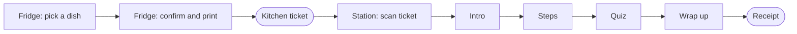

These screenshots show the Omelette lab. The other dishes use the same screens with their own content from [`content/labs.json`](content/labs.json).

### Fridge

| 1. Pick a dish | 2. Confirm and print a ticket |
|---|---|
| 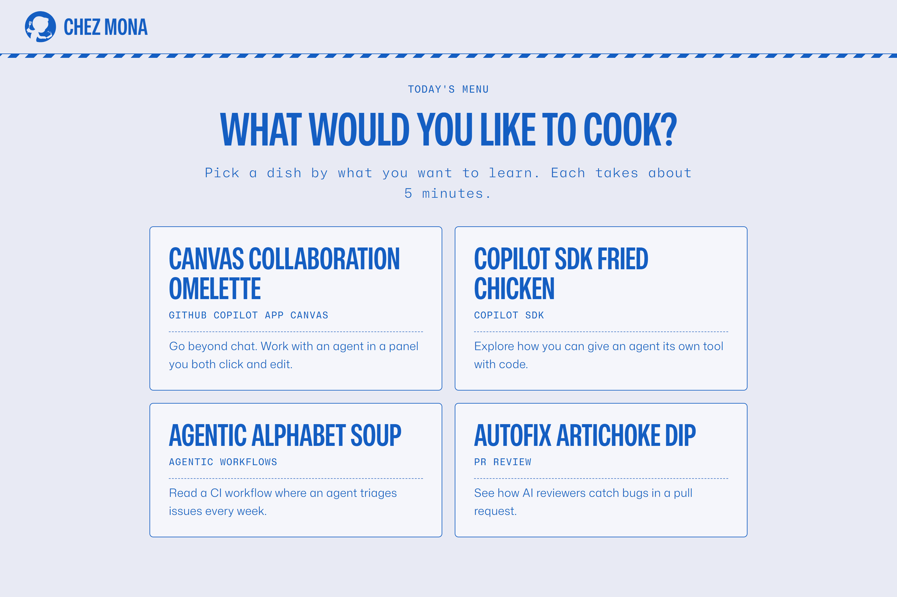 | 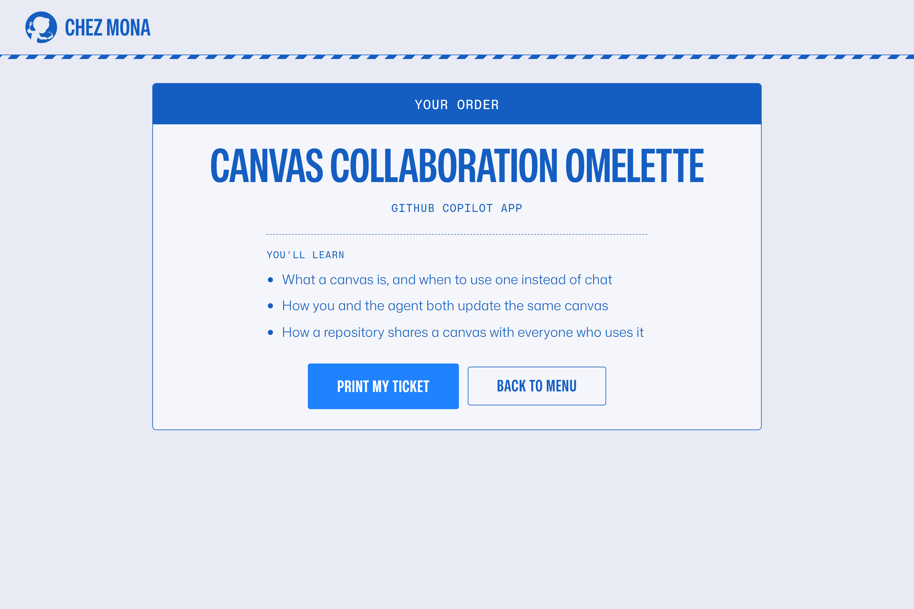 |

### Cooking station

| 3. Scan the ticket | 4. Read the intro |
|---|---|
| 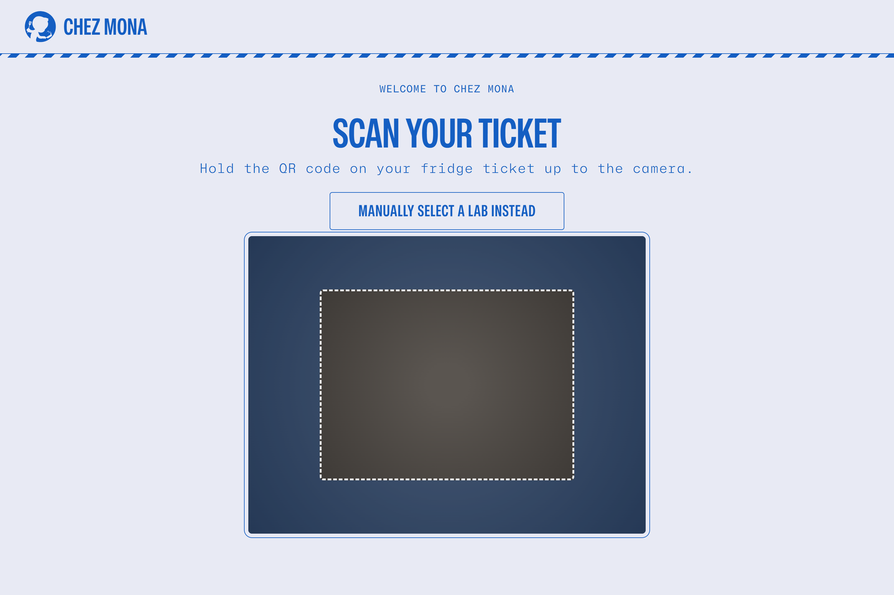 | 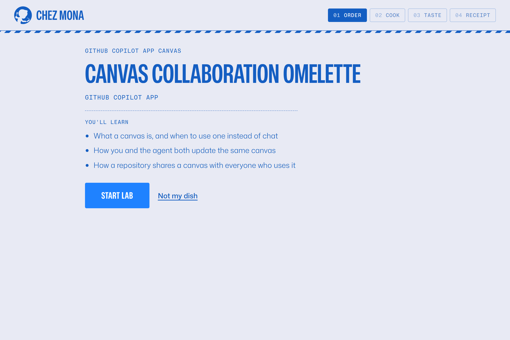 |

| 5. Follow the steps | 6. Answer the quiz |
|---|---|
| 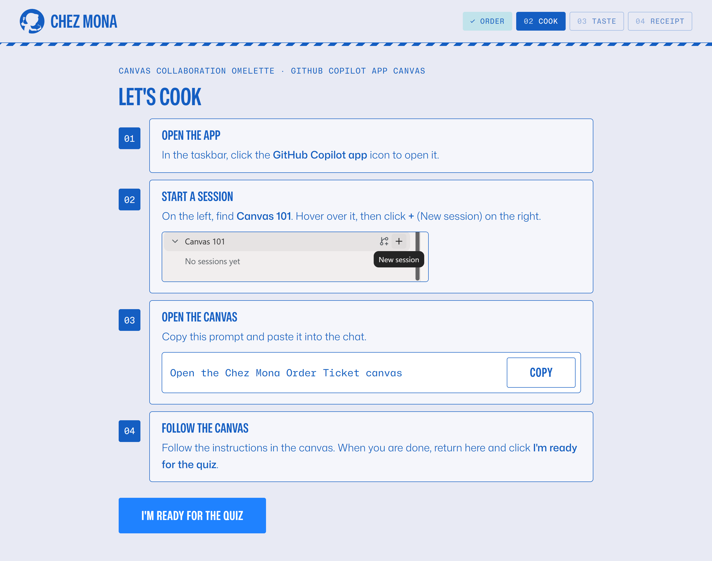 | 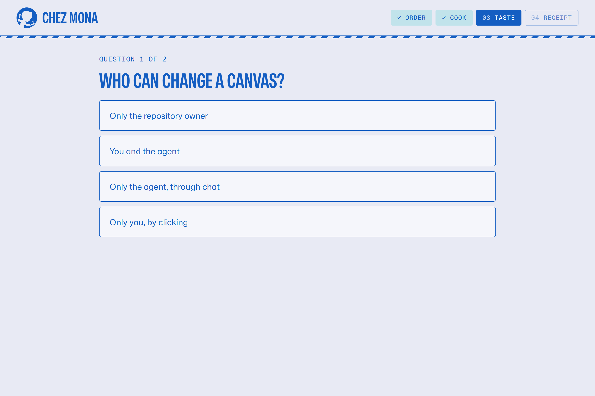 |

| 7. Wrap up | 8. Take the receipt |
|---|---|
| 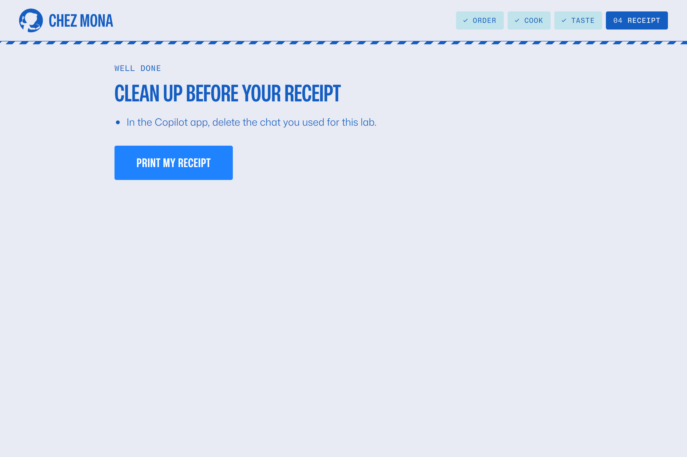 | 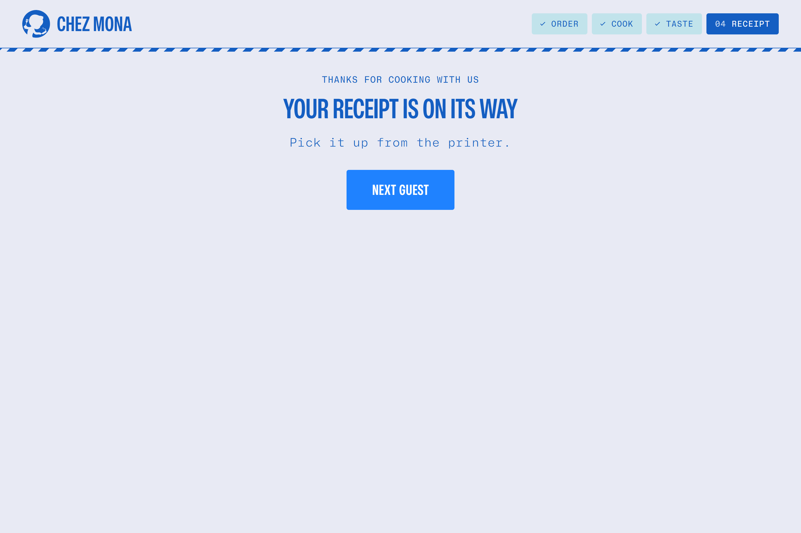 |

### Printouts

These are previews of the layouts in [`chez_mona/receipt.py`](chez_mona/receipt.py). Real prints use the printer's own font.

| Kitchen ticket (fridge) | Receipt (station) |
|---|---|
| 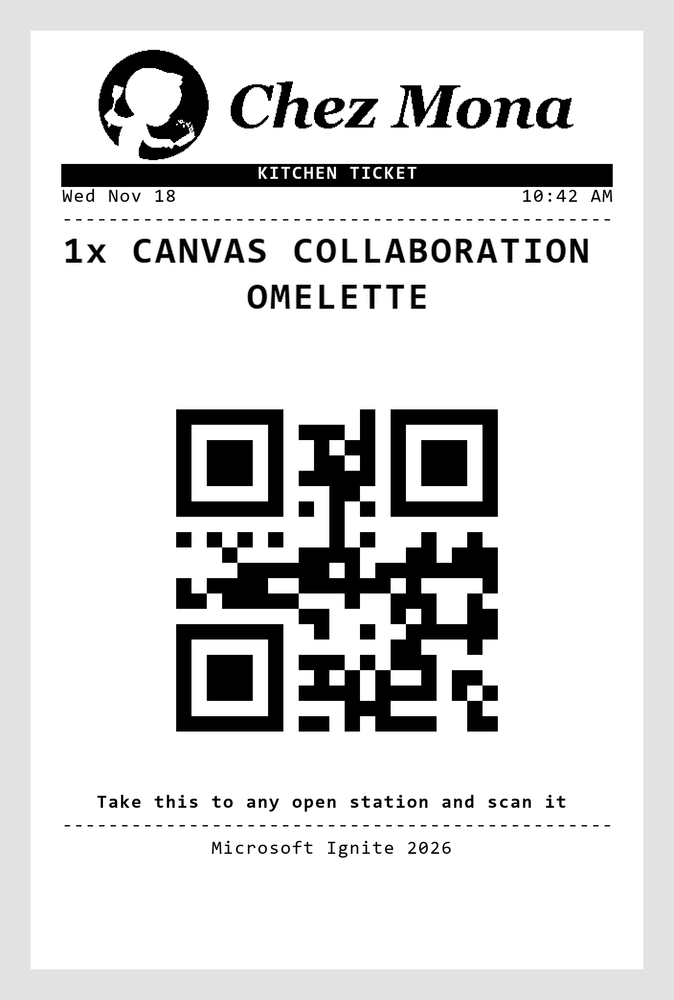 | 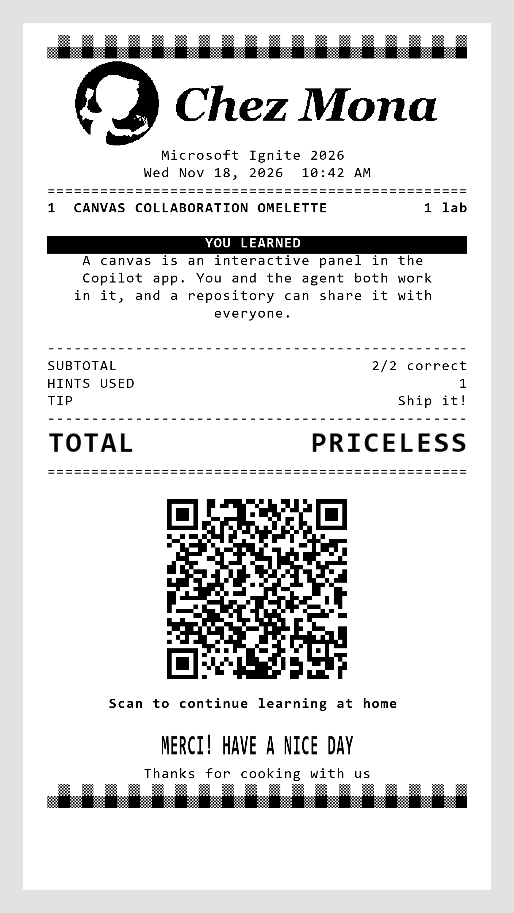 |

## Layout

| Path | Contents |
|---|---|
| [`chez_mona/`](chez_mona/) | Server (`server.py`), Fried Chicken VS Code session (`sdk_session.py`), ticket and receipt layouts (`receipt.py`), USB printing (`printer.py`), station role (`config.py`), content loader (`labs.py`) |
| [`content/labs.json`](content/labs.json) | Every dish: menu `pitch`, `uses` and `about` points for the confirm and intro screens, steps (a short `text` title, an optional lighter `body` line, an optional `image` under [`static/`](static/) with `alt` text, and an optional `prompt` shown with a **Copy** button), quiz with other choices and hints, wrap up, receipt summary (`receipt.summary`, one short paragraph) and QR link |

| [`static/`](static/) | The cooking station page (`index.html`, `app.js`), the fridge page (`fridge.html`, `fridge.js`), shared `app.css`, vendored [Mona Sans and Mona Sans Mono](https://github.com/github/mona-sans) web fonts in `fonts/`, and vendored [jsQR](https://github.com/cozmo/jsQR) for webcam scanning |
| [`docs/screenshots/`](docs/screenshots/) | Screenshots and printout previews for the [guest flow](#guest-flow) |
| [`start.ps1`](start.ps1) | Starts a cooking station (`.\start.ps1 station`) or a fridge kiosk (`.\start.ps1 fridge`) and opens it in an Edge app window |
| [`tests/`](tests/) | Unit tests |

## Set up a laptop

Follow [SETUP.md](SETUP.md) to install and check a [cooking station](SETUP.md#cooking-station) or a [fridge laptop](SETUP.md#fridge-laptop).

## Run

Each laptop runs one of the two programs. On the 6 cooking stations:

```powershell
cd launcher
.\start.ps1 station
```

On the 2 fridge laptops:

```powershell
cd launcher
.\start.ps1 fridge
```

The script starts the server, waits for it, then opens the page in an Edge app window: `http://localhost:8765` for a station and `http://localhost:8766` for a fridge, so both can run on one laptop for testing. Press Ctrl+C in the console to stop. On stop, a cooking station closes any Fried Chicken VS Code window and deletes its folder. Add `-NoBrowser` to skip the Edge window, or `-Port N` to use another port. If the port is already taken, for example by a second station window, the script stops with an error.

To run the server alone: `uv run python -u -m chez_mona [--role station|fridge] [--port N]`.

Everything else is fixed for the booth hardware: the one attached USB printer, 80 mm paper (576 printable dots), VS Code from `PATH` or its default install folder.

## Staff controls

- Guests can tap **Manually select a lab instead** on the Scan screen to pick any dish without a ticket or camera. **Scan a ticket instead** returns to scanning.
- Press **Ctrl+Shift+M**, or hold the Chez Mona logo for 3 seconds, to open the staff panel. It lets you pick a dish without scanning, shows the printer status and returns to Scan.
- After a print error, the Print screen offers **Staff: print again**. The launcher never retries on its own, so a guest never gets two receipts by accident.
- Tickets hold only the dish ID: `omelette`, `fried-chicken`, `soup` or `dip`. Case does not matter, and spaces or underscores count as hyphens.
- On a fridge, **Ctrl+Shift+M** shows the printer status. After a ticket print error, **Try again** prints once more; check the printer first, because the first attempt may have printed.

## How Fried Chicken works

1. **Start lab** copies [`copilot-sdk/`](../copilot-sdk/) to `%LOCALAPPDATA%\ChezMona\guests\chez-mona-fried-chicken-<id>`, without caches or virtual environments. It adds workspace settings that turn on auto save, so closing never stops on an unsaved changes prompt.
2. **Open in VS Code** in Explore step 1 runs `code --new-window --disable-workspace-trust <folder> <folder>\main.py`. If the window is already open, it uses `--reuse-window` to focus it. If the guest closed it, the button opens it again.
3. VS Code opens only when the guest clicks, so it does not cover the steps before the guest reads them.
4. Wrap up, the idle timeout and stopping the server close VS Code windows whose title contains the folder name, then delete the folder. Leftover folders are also removed when the server starts and before each new guest.

## Edit lab content

Edit [`content/labs.json`](content/labs.json). In text, use only `` `code` `` and `**bold**`. The server checks the file at start and refuses to run if something is missing, for example a quiz without exactly two questions and three other choices, a link that is not `https`, or a Markdown page that does not exist. Receipts print in plain ASCII, so other characters show as `?`.

## Test

```powershell
cd launcher
uv run python -m unittest discover -s tests
```

The tests cover content validation, the station role, ESC/POS output for tickets and receipts, the Fried Chicken session with a fake VS Code, and the server endpoints with a fake printer.

With Node.js installed, run the station UI tests from `launcher`:

```powershell
node --test tests\test_app.cjs
```

These cover manual lab selection, returning to scanning, and unavailable or pending cameras.
