# How it works

The launcher is a local web app that runs the booth flow on each laptop. A guest scans a fridge ticket or chooses a lab on screen, reads the intro, explores the lab, takes a two question quiz, wraps up and prints a receipt. The same app also runs the fridge wall kiosks that print the tickets.

A small Python server listens on `localhost` only. It serves the page and does the local work the browser cannot: copy the Fried Chicken starter, open and close VS Code, send tickets and receipts to the printer, and [count labs](run-booth.md#get-lab-counts).

## Guest flow

The two apps work together through the printed ticket. The ticket QR code holds only the dish ID.

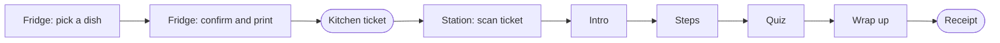

These screenshots show the Omelette lab. The other dishes use the same screens with their own content from [`content/labs.json`](../content/labs.json).

### Fridge

| 1. Pick a dish | 2. Confirm and print a ticket |
|---|---|
| 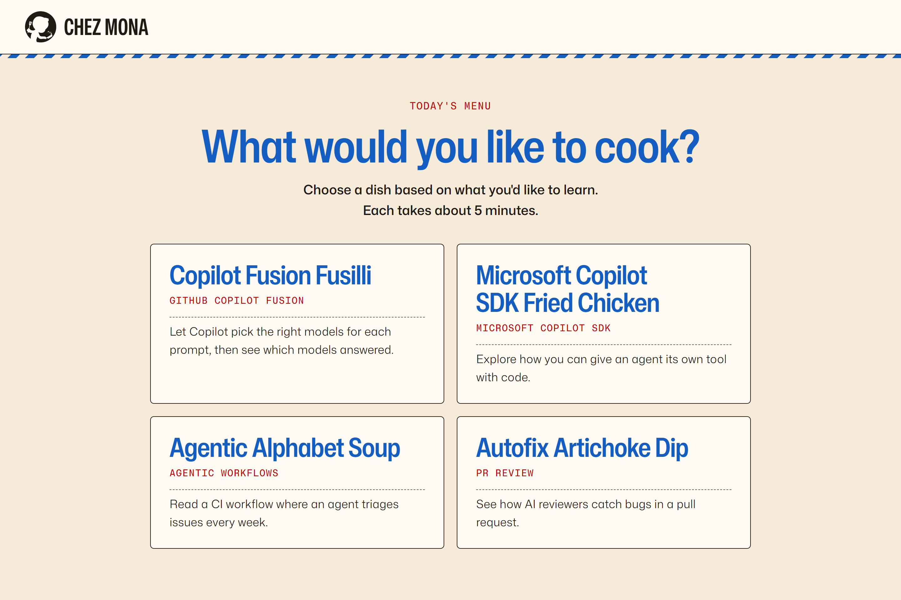 | 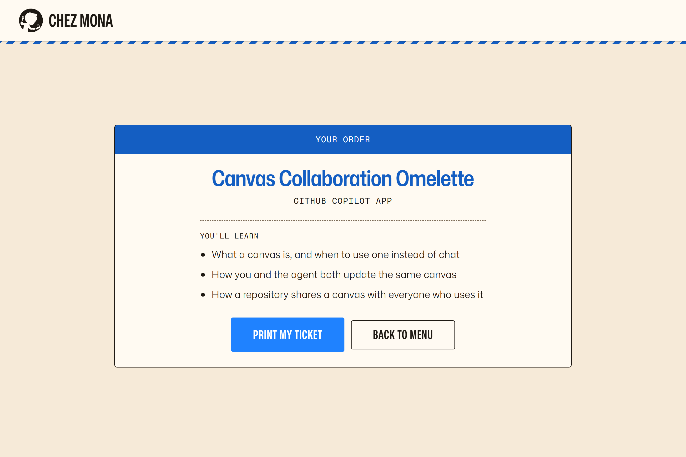 |

### Cooking station

| 3. Scan the ticket | 4. Read the intro |
|---|---|
| 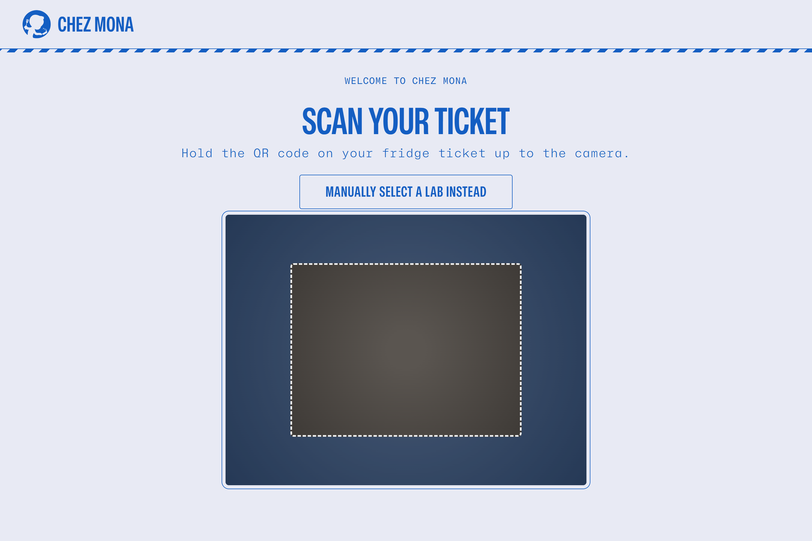 | 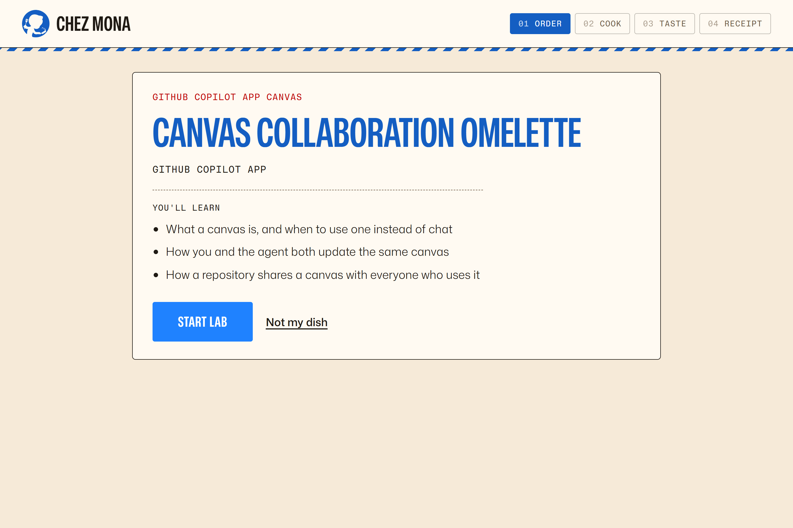 |

| 5. Follow the steps | 6. Answer the quiz |
|---|---|
| 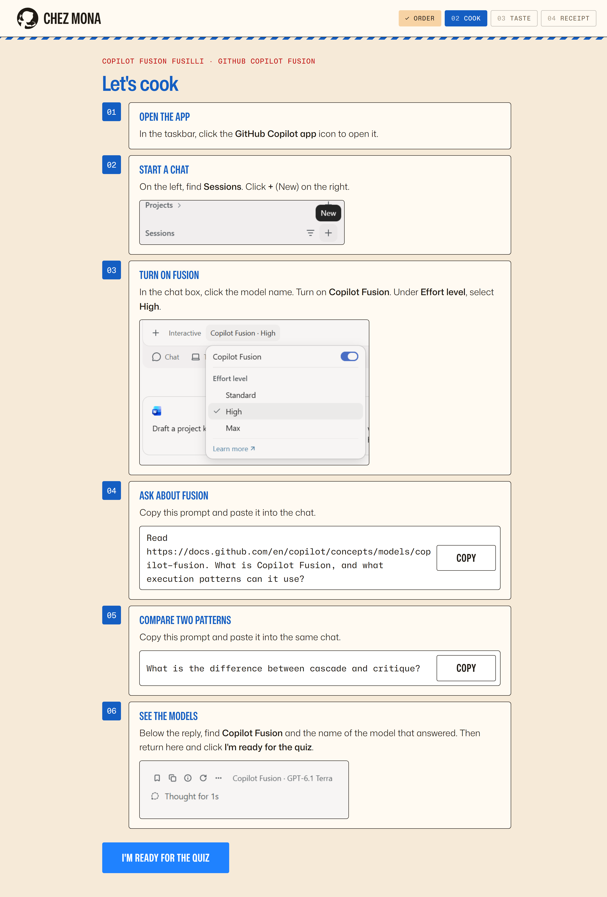 | 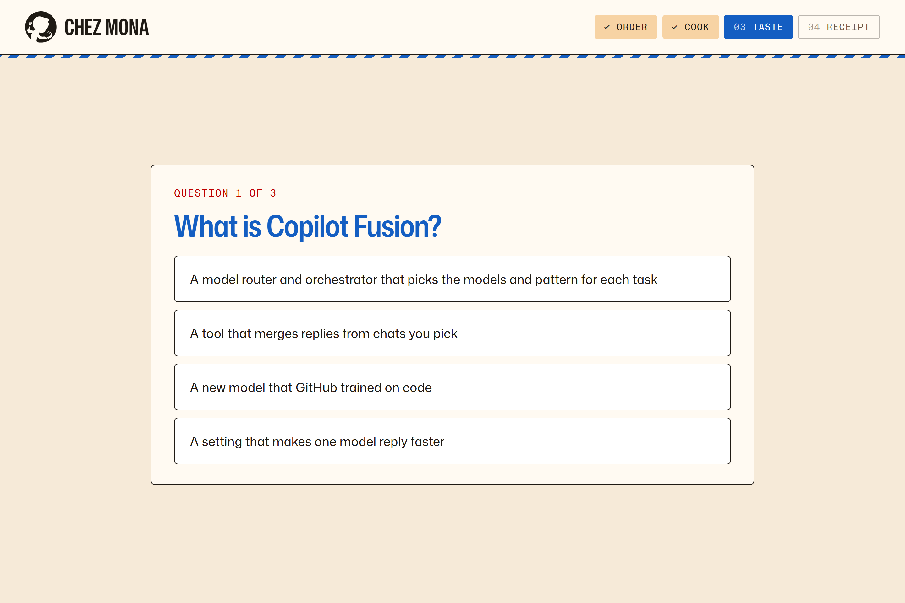 |

| 7. Wrap up | 8. Take the receipt |
|---|---|
| 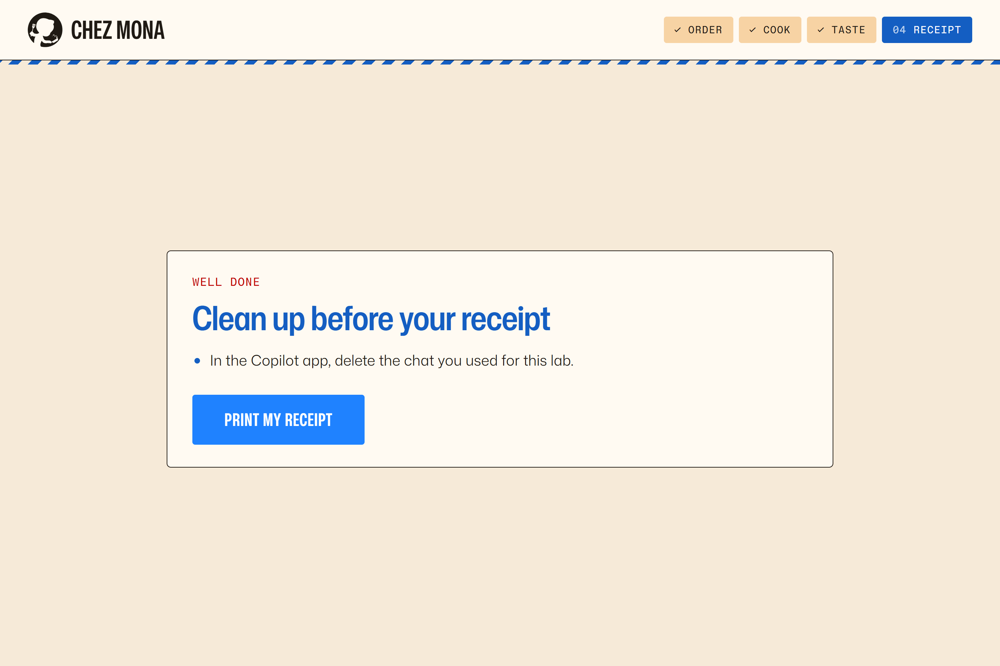 | 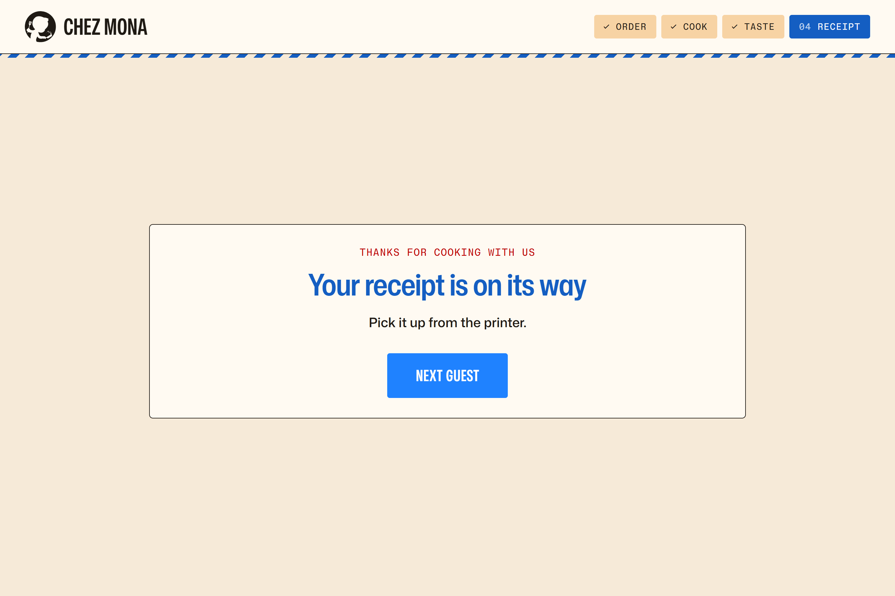 |

### Printouts

These are previews of the layouts in [`chez_mona/receipt.py`](../chez_mona/receipt.py). Real prints use the printer's own font.

| Kitchen ticket (fridge) | Receipt (station) |
|---|---|
| 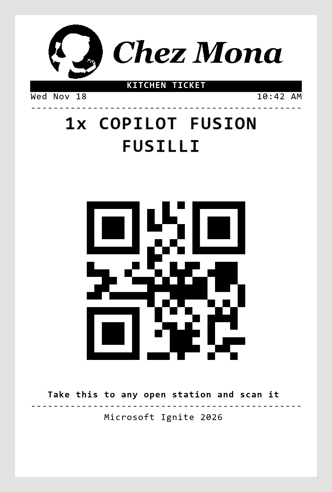 | 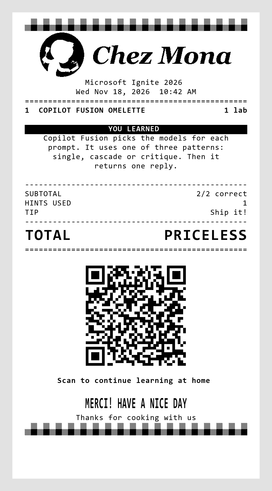 |

## Fried Chicken

1. **Start lab** copies [`copilot-sdk/`](../../copilot-sdk/) to `%LOCALAPPDATA%\ChezMona\guests\chez-mona-fried-chicken-<id>`, without caches or virtual environments. It adds workspace settings that turn on auto save, so closing never stops on an unsaved changes prompt.
2. **Open in VS Code** in Explore step 1 runs `code --new-window --disable-workspace-trust <folder> <folder>\main.py`. If the window is already open, it uses `--reuse-window` to focus it. If the guest closed it, the button opens it again.
3. VS Code opens only when the guest clicks, so it does not cover the steps before the guest reads them.
4. Wrap up, the idle timeout and stopping the server close VS Code windows whose title contains the folder name, then delete the folder. Leftover folders are also removed when the server starts and before each new guest.

## Hardware

The booth has 6 cooking station laptops and 2 fridge laptops, all identical Surface laptops on Windows. Each laptop has its own Rongta RP326 receipt printer, connected by USB. Every laptop gets the same setup. See [Set up a booth laptop](setup.md).

The launcher talks to the printer directly over USB. It does not use a Windows print queue, a driver or a printer name.

- It uses the first USB printer it finds. It ignores Wi-Fi, network and virtual printers like "Microsoft Print to PDF".
- It sends raw ESC/POS commands for 80 mm paper.
- Before each job, it asks the printer for its status. It does not print if the cover is open or the paper is out.

## Files

| Path | Contents |
|---|---|
| [`chez_mona/`](../chez_mona/) | Server (`server.py`), Fried Chicken VS Code session (`sdk_session.py`), ticket and receipt layouts (`receipt.py`), USB printing (`printer.py`), station role (`config.py`), content loader (`labs.py`), lab counts (`stats.py`) |
| [`content/labs.json`](../content/labs.json) | Every dish. |
| [`static/`](../static/) | The cooking station page (`index.html`, `app.js`), the fridge page (`fridge.html`, `fridge.js`), shared `app.css`, vendored [Mona Sans and Mona Sans Mono](https://github.com/github/mona-sans) web fonts in `fonts/`, and vendored [jsQR](https://github.com/cozmo/jsQR) for webcam scanning |
| [`docs/`](.) | These pages, with screenshots and printout previews in `screenshots/` |
| [`start.ps1`](../start.ps1) | Starts a cooking station or a fridge kiosk. See [Start a laptop](run-booth.md#start-a-laptop). |
| [`tests/`](../tests/) | Unit tests. Run them from `launcher` with `uv run python -m unittest discover -s tests`. |
